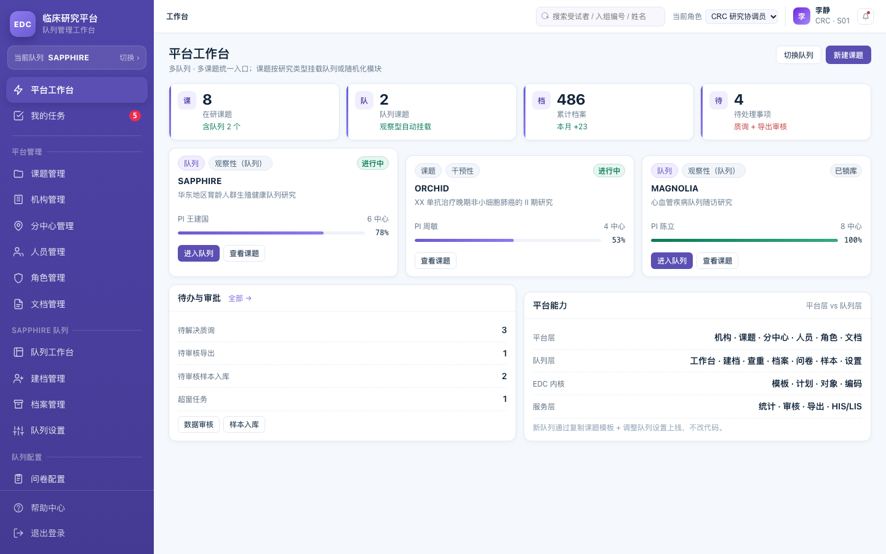

# 临床研究队列管理平台 · 交互原型

融合「EDC 平台」与「单队列管理系统」的交互原型：以平台层为公共底座，队列层承载单队列全生命周期，覆盖建档、查重、档案、问卷、随访、样本、采集、质控、统计与导出。



## 在线演示

https://yameibo.github.io/Clinical-Studies-Cohorts/

> 若链接暂不可用，请在仓库 **Settings → Pages** 中将 Source 设为 `Deploy from a branch`，分支选 `main`、目录选 `/ (root)`。

## 原型包含

- **平台管理**：平台工作台、课题、机构、分中心、人员、角色、文档
- **队列运营**：队列工作台、建档管理、重复建档查询、档案管理（CRF 状态矩阵）
- **队列配置**：问卷配置（发布 / 版本）、随访计划、样本管理（时点 × 类型矩阵、入库审核）、队列设置
- **采集与质控**：对象管理、CRF 采集校验、质询闭环、超窗、数据审核、双录入、随机化
- **统计与交付**：队列统计、表单统计、数据导出
- **外部集成**：HIS/LIS 集成日志与重试

## 方案文档

- [融合规划方案](docs/临床研究队列管理平台-融合方案.md)
- [方案汇报页](docs/方案3-融合规划方案.html)
- [方案思维导图（融合版）](docs/方案1-思维导图-融合版.html)

## 本地预览

```bash
python3 -m http.server 8080
# 打开 http://localhost:8080
```

## 说明

- 单文件 HTML，无外部依赖，直接双击 `index.html` 也可运行
- 全部数据为模拟数据，操作即时生效但不落库
- 支持通过 `#home`、`#cohort`、`#archives` 等锚点直达页面
