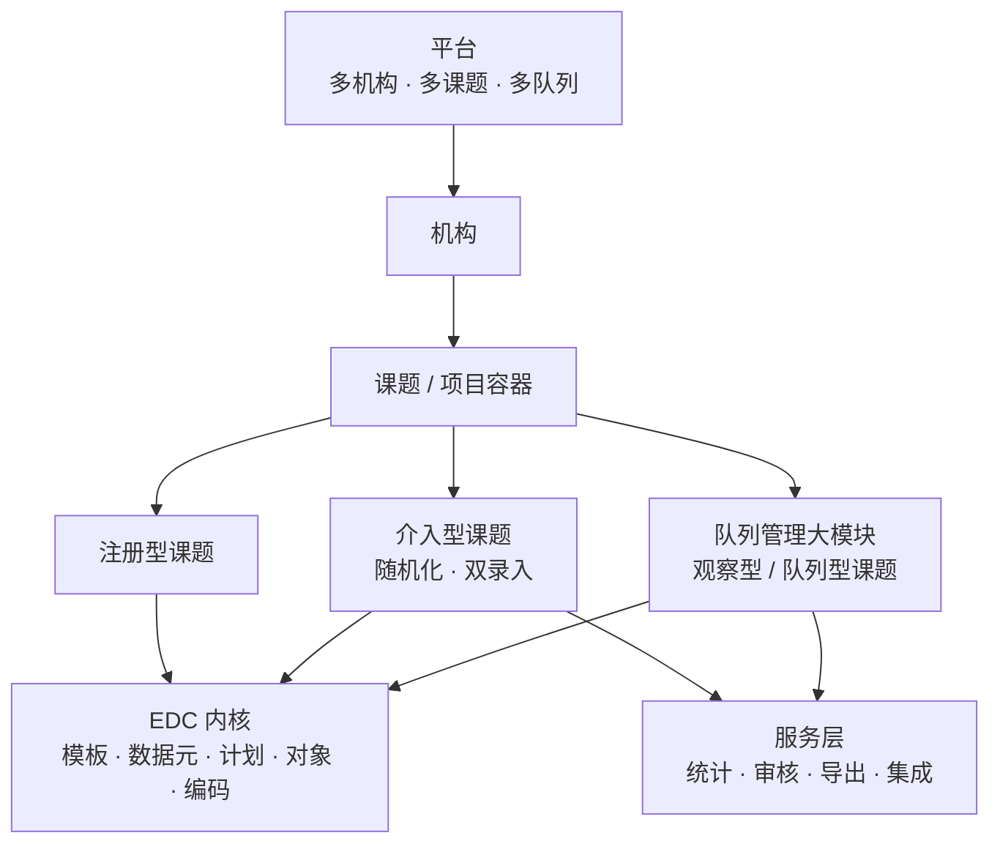
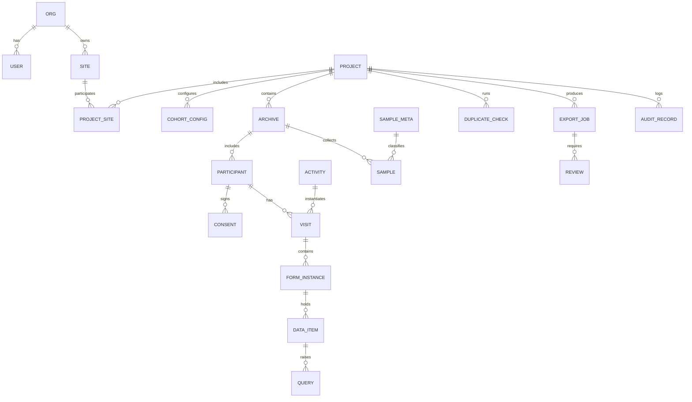

# 临床研究队列管理平台 · 融合规划方案

> 版本：V2.0（融合版）｜ 日期：2026-11-13
> 融合来源：
> - **方案1**《临床专项研究与队列管理系统 · 方案思维导图》（5 大模块 / 25 条参数）
> - **方案2**《临床专项研究与队列管理系统（EDC）技术方案 V1.1》（25 条参数 + 4 项增补 + 技术架构）
> - **规划依据**《临床研究队列管理平台规划设计方案 V1.0》（18 页，2026-11）
>
> 融合结论：采用「**平台层 + 队列层 + EDC 内核层 + 服务层**」四层架构，以 5 大功能域承载。
> 原 25 条技术参数全部保留；4 项客户增补（随机化 / 双录入 / 样本管理 / HIS-LIS 集成）保留；新增 6 项队列增强（Q1–Q6）。
> 部署：院内私有化 ｜ 并发：100 用户 ｜ 导出：Excel / CSV ｜ 电子签名：暂不启用 ｜ 微信端：配置保留、暂不启用

---

## 1. 融合背景与目标

### 1.1 两套系统的短板

| 系统 | 优势 | 短板 |
|---|---|---|
| 临床研究 EDC 平台（方案2） | 机构、课题、模板、计划、质询、统计、导出等配置化能力完整 | 缺少面向单一队列的一站式操作台；建档、查重、档案矩阵、问卷、样本链路不完整 |
| 单队列调查系统（方案1） | 建档、查重、档案检索、问卷、样本单上传、全量导出贴近队列业务 | 字段与流程硬绑定具体研究主题，无法复用到其他队列 |

**融合思路**：以 EDC 平台为公共底座，把单队列系统的页面抽象为可配置的「队列管理大模块」，平台层支持多机构、多课题、多队列并行，队列层负责单队列全生命周期。

### 1.2 建设目标

1. **一个平台承载全部队列与课题**：多机构、多课题、多分中心共存，数据与权限互相隔离。
2. **单队列全生命周期闭环**：建档 → 查重 → 档案 → 问卷 → 随访 → 样本 → 采集 → 质控 → 统计 → 导出。
3. **配置化而非硬编码**：对象状态、双方/家庭结构、采样时点、样本类型、问卷填写角色、导出类型、档案编码、查重规则全部为配置项。
4. **不丢既有能力**：原 25 条参数、4 项增补、单队列系统页面要素全部保留。
5. **对标主流产品**：以 REDCap 为主，OpenClinica / Castor / Medidata Rave / OpenSpecimen 为辅，验证模块划分与数据流。

### 1.3 设计原则

- **平台化**：机构、人员、权限、文档、模板、数据元下沉平台层；队列模块只做队列业务。
- **配置优先**：新队列通过「复制课题模板 + 调整队列设置」上线，不改代码。
- **四维权限**：页面、操作、数据范围、导出字段分离，导出精确到 CRF 数据项。
- **合规可追溯**：数据审核、操作日志、导出留痕、课题锁定满足科研数据管理与伦理审查要求。
- **一套底座、多态挂载**：观察型/队列型课题挂载队列模块；介入型课题按开关挂载随机化、双录入。

---

## 2. 市场对标与逻辑验证

| 本平台模块 | REDCap / 同类产品 | 验证结论 |
|---|---|---|
| 课题（项目）管理 | REDCap Project（项目容器、项目复制） | 成立：课题即容器，多课题并行 |
| 模板制作 / 问卷配置 | Data Dictionary + Online Designer / Instruments | 成立：表单即 Instrument，题目即字段 |
| 随访计划配置 | Longitudinal Events + Scheduling | 成立：主干访视对应纵向事件，窗口期/提醒/时间点一一对应 |
| 分支组别 | Branching Logic + Data Access Groups | 成立：字段条件自动入组 + 手动分组 |
| 建档与查重 | Record 创建 + 唯一标识查重 | 成立：档案编号即 Record ID，证件号/姓名+生日查重 |
| 对象管理与采集 | Record Status Dashboard + 状态灯 | 成立：表单提交状态矩阵 |
| 数据质控 | OpenClinica Discrepancy Notes / REDCap Data Quality | 成立：字段级质询、双类型、留言闭环 |
| 角色权限 | User Rights + DAG | 成立：四维权限是 User Rights 的细化 |
| 数据导出与记录 | Data Exports + Logging | 成立：条件导出对应 Report Builder，记录对应审计日志 |
| 样本管理 | REDCap 无内置，参照 OpenSpecimen / LIMS | 必要扩展：按时点 × 类型建登记表 |
| 任务日历 / 超窗 | REDCap Calendar / OpenClinica Visit Tracking | 成立：计划、到访、超窗为标准要素 |
| 随机化 / 双录入 | REDCap Randomization + Double Data Entry | 成立：作为课题属性开关挂载，队列型课题关闭即可 |

**结论**：平台—课题—队列三层模型、模板即数据字典、计划即纵向事件、四维权限、队列模块即单项目操作台，均与国际主流范式一致；样本链路作为队列研究的必要扩展。

---

## 3. 总体架构

### 3.1 四层技术架构

| 层级 | 组成 | 职责 |
|---|---|---|
| **平台层** | 机构管理、课题管理、分中心管理、人员与角色权限、平台工作台、文档管理 | 多队列/多课题公共底座，资源与权限隔离 |
| **队列层** | 队列工作台、建档、查重、档案、问卷、随访计划、样本、采集、质控、导出、统计、队列设置 | 单一队列全生命周期一站式管理 |
| **数据层（EDC 内核）** | 模板制作、数据元统计、计划配置、对象管理、对象登记、自定义编码、对象字段映射 | 表单与数据结构定义，被队列层与各课题复用 |
| **服务层** | 统计分析、数据审核、数据导出、外部集成（HIS/LIS、标签打印、微信预留） | 数据输出、审核流与第三方对接 |

### 3.2 五大功能域（产品视角）

| 功能域 | 覆盖内容 | 主要用户 |
|---|---|---|
| **M1 平台管理** | 机构、课题、分中心、人员、角色、平台工作台、文档 | 平台管理员、机构管理员、PI |
| **M2 队列运营** | 队列工作台、建档、重复建档查询、档案管理 | 建档员、CRC、PI、档案管理员 |
| **M3 队列配置** | 问卷配置、随访计划、样本管理、队列设置、模板/数据元/编码 | 建库人员、DM、样本管理员 |
| **M4 采集与质控** | 对象/访视、数据采集、脱落、日历、质询、超窗、数据锁定、双录入、随机发号 | 研究者、CRC、CRA、DM |
| **M5 统计交付与集成** | 课题/中心/质询/表单统计、数据导出、导出记录、数据审核、HIS/LIS | PI、CRA、DM、统计人员 |

### 3.3 平台—课题—队列关系

**挂载规则**：
- 研究类型 = 观察型（队列研究）→ 自动挂载队列管理大模块；开启「启用样本」后样本子模块可见。
- 研究类型 = 介入型 → 按课题属性开关挂载随机化、分组、双录入。
- 研究类型 = 注册型 → 平台 + EDC 内核 + 统计导出。
- 队列之间数据完全隔离；档案编号规则独立；导出审核按课题归属流转。

### 3.4 分层与功能域对应

| 功能域 | 平台层 | 队列层 | EDC 内核层 | 服务层 |
|---|---|---|---|---|
| M1 平台管理 | ● | — | — | — |
| M2 队列运营 | — | ● | ○ | — |
| M3 队列配置 | — | ● | ● | — |
| M4 采集与质控 | — | ● | ● | ○ |
| M5 统计交付 | — | ● | — | ● |

> ● 主要承载；○ 复用能力。

---

## 4. M1 平台管理域

### 4.1 机构管理（参数 1）

- 机构列表：机构名称、机构用户数。
- 新增/编辑：机构编码、名称、等级、地址（省/市/区县）。
- 删除保护：机构下有用户时不可删除。
- 机构用户：工号、姓名、邮箱、手机号、职务、状态；新增/编辑/删除；设机构管理员、启用/停用、重置密码；Excel 模板下载/导入；按工号或姓名搜索。

### 4.2 课题管理（参数 2）

- 课题列表：编码、简称、PI、申办机构、起止日期、进度、附件个数。
- 新增/编辑：编码、名称、简称、负责机构、PI、起止日期、摘要、关键词。
- **课题属性**：研究类型、方案验证日期、课题继承、研究目的、分配方式、研究阶段、盲法、干预模型、研究项目分类、计划入组数、条件描述、关键字、合规标准、计划中心数、招募、强制修改、是否多中心、启用分组/随机化/样本/双录入。
- **课题设置**：CO-PI、标签打印、编码自动生成、外部数据接入、对接微信（配置保留、本期不启用）。
- 进度：整体进度 = 实际入组 / 计划入组；活动进度 = 完成访视 / 活动实际入组。
- 锁定/解锁；按简称或 PI 搜索。
- **队列开通**：观察型课题自动挂载队列模块；「启用样本」控制样本子模块可见。

### 4.3 分中心管理（参数 5）

- 列表：中心编码、从属机构、名称、负责人、计划入组数。
- 新增/编辑/删除（二次确认，含其中用户）。
- 课题添加已有分中心：可跨机构选择，添加时重设课题内编码与计划入组数。
- 按编码或名称搜索。

### 4.4 人员与角色（参数 6、7）

- 分中心人员：工号、性别、姓名、手机、职务、角色、状态；新增/编辑；Excel 批量导入/导出；重置密码；进入/移出分中心并绑定角色；搜索。
- 角色：编码、名称、级别；新增/编辑/删除。
- **四维权限**：页面、操作、数据（课题/机构/中心/个人）、导出（精确到 CRF 数据项）。
- **队列角色扩展**：建档员、随访员、样本管理员、档案管理员，均可绑定到课题/中心。
- 盲底与揭盲权限单独授权，不随普通权限继承。

### 4.5 平台工作台（参数 4）

- 多课题总览：课题名称、实际入组数、任务进度、质询跟踪。
- 近一周项目详情：起始时间、PI、分中心数、科研用户数、及时率、质询率、完成率。
- 与队列工作台分工：平台工作台看「多课题」，队列工作台看「单队列」。

### 4.6 文档管理（参数 3）

- 按课题管理文件/文件夹；文件夹新建/编辑/删除。
- 上传：txt、xls、xlsx、csv、jp2、jpeg、png、docx、doc、pdf、pptx、zip、rar；批量上传。
- 编辑/删除（批量）、按名称搜索；可设置「是否有分数」。
- 文档与 CRF 数据分离，权限跟随课题。

---

## 5. M2 队列运营域（队列增强 Q1–Q4）

### 5.1 队列工作台（Q1）

- 快捷入口：新建档案、重复建档查询、档案管理、样本管理单上传。
- 队列概览：累计入组数、各表单完成率、待办（待审核样本入库单、待解决质询、超窗任务）。
- 所有队列角色可见；快捷入口按页面权限显隐。

### 5.2 建档管理（Q2，融合参数 18）

**新建档案**
- **知情同意**：选择是否签署；选「是」后方可上传知情同意书（图片，≤ 6MB）。
- **对象状态标签**：可配置枚举（示例：婚前、孕前、孕期、子代），标识研究阶段。
- **关键日期**：如结婚日期，可配置是否启用、是否必填。
- **关联对象结构**：支持单方 / 双方 / 家庭多方；示例为女方、男方两组可折叠分组，各含姓名、出生日期、证件号码等；结构由队列设置配置。
- **登记信息**：姓名、姓名缩写、性别、出生年月、评估人、评估中心。
- **操作**：重置表单、创建档案；创建后按自定义编码规则生成档案编号。
- **批量建档**：模板批量导入。

### 5.3 重复建档查询（Q3）

- 查重条件：证件号码、姓名 + 出生日期等组合，规则可配置。
- 查重结果：疑似重复档案列表（档案编号、建档机构、建档日期、双方姓名），可查看详情。
- 处理：确认重复后可合并档案或标记关联；新建档案保存时自动触发查重提示。
- 判定策略：完全匹配、模糊匹配分级；误报可标记「非重复」并留痕。

### 5.4 档案管理（Q4）

**检索条件**
- 档案编号（家庭编号）、建档机构、建档时间、基线档案完成状态。
- 关联对象条件：女方/男方姓名、出生日期、证件号码（随结构配置变化）。

**档案列表**
- 基础列：勾选框、档案编号、建档机构、双方姓名、双方证件号码、建档日期（可排序）。
- **状态矩阵**：每份 CRF 表单一列（如基础健康状况、基线调查问卷、早孕随访、中晚孕随访、妊娠结局、产后 42 天随访等），以已提交/未提交状态灯标识。
- 分页与每页条数可选。

**批量导出**
- 全量导出、全量导出（英文）、全量导出（映射）、问卷导出、问卷导出（英文）、名单全量下载、知情同意书下载。
- 导出动作生成任务并进入导出记录中心；按角色导出权限控制到字段级。

**档案操作**
- 查看/编辑档案、进入数据采集、脱落（填写原因）、新建档案。

---

## 6. M3 队列配置域

### 6.1 问卷配置（Q5）

- 问卷列表：名称、题目数量、填写人员（角色标签）、状态（已发布/未发布）。
- 操作：创建、修改、复制、预览、删除、批量发布、按名称搜索、分页。
- 设计器：题目维护、字段类型、校验规则；可引用共享数据元。
- **版本管理**：变更通过复制生成新版本，已采集数据保持可追溯。
- **填写角色**：指定医生端 / 对象端 / 关联对象端；与微信端展示联动（微信本期不启用）。

### 6.2 随访计划配置（参数 10）

- 活动列表：活动名称、表单个数；新增/编辑（编码、名称）；已启动方案中的活动不可删除。
- 活动配置：关联模板、是否必填、微信端是否显示（配置保留）。
- 主干访视：访视编码、类型（非计划/计划/循环）、是否计划时间点、起点（基线/登记表单）、计划时间点（入组日期/出生年月/签名日期）、间隔（年/月/日）、提醒天数、窗口期、微信展示、角色表单权限、附件类型。
- 分支组别：手动选择受试者入组，或按 CRF 字段条件自动入组。
- 登记表单：选择模板作为入组登记表单。
- 计划启用/禁用：启用后主干、分支及属性不可编辑删除；禁用后可维护。

### 6.3 样本管理（E3 增补，融合 PDF 5.7）

**登记表单体系**
- 通用：生物样本入库登记表、样本入库登记表审核（置顶页签）。
- 时点：样本采集登记表、样本处理与暂存登记表。

**采样时点 × 样本类型**
- 采样时点（可配置分组）：基线、早孕、中晚孕、分娩时、脐带血、胎盘、产后 42 天等。
- 样本类型（可配置）：血清、非抗凝血、抗凝血、尿液、阴道分泌物、冻存组织、剩余血清等。
- 每个「时点 × 类型」组合对应一张处理与暂存登记表；上传后进入入库登记表，审核后完成入库闭环。

**功能要点**
- 样本编码规则化、全局唯一；库位精确到冰箱/层/架/盒/孔。
- 状态：已采集 → 已入库 → 已出库 → 已销毁，全程留痕。
- 与「启用样本」「标签打印」联动；支持标签打印与扫码定位（可选）。
- 样本列表按课题/中心/类型/状态筛选，导出 Excel/CSV。

### 6.4 队列设置（Q6，融合参数 15、16）

| 配置组 | 配置项 |
|---|---|
| 建档配置 | 登记字段映射、双方/家庭信息结构、对象状态枚举、关键日期字段、患者列表显示字段 |
| 查重配置 | 查重字段组合、匹配级别、疑似重复判定规则 |
| 样本配置 | 采样时点分组、样本类型字典、登记表单关联 |
| 问卷配置 | 问卷创建、发布、填写角色管理入口 |
| 自定义编码 | 生成元素、前缀（时间戳/自定义/课题编码/分中心编码）、分隔符、流水号、只读、样例预览 |

### 6.5 模板与数据元（参数 8、9）

- 模板：列表、新增/编辑/删除（被引用不可删）、字段与自定义字段、引用共享数据元、预览、导入/导出（模板/数据元/JSON）、按名称检索。
- 数据元：编码、名称、使用次数、使用详情（关联表单列表），支撑跨队列复用与标准化。
- 模板与问卷共用同一套数据字典；问卷是模板在队列场景下的业务视图。

---

## 7. M4 数据采集与质量控制域

### 7.1 对象与访视（参数 17）

- 对象列表：入组编号、姓名、性别、入组日期、研究标签、登记日期。
- 访视列表：入组编码、姓名、活动；活动状态（未完成、已完成、有质询、脱落、锁定、已解决、未开始、停止）。
- 访视详情：访视名称、计划日期、随访日期、完成日期、知情、录音、表单完成进度。
- 操作：新增患者、脱落、表单填写/保存/提交/分享/打印、附件上传、文本备注、质询查看与留言。
- 研究标签：可新增、删除。

### 7.2 对象登记（参数 18）

- 登记入组：姓名、姓名缩写、性别、出生年月、评估人、评估中心。
- 批量导入受试者。
- 与队列建档打通：档案（家庭）1:N 对象（参与者），建档后自动生成对象登记信息。

### 7.3 质控闭环（参数 21、22、23、19、20）

- **访视质询**：质询列表、活动状态；新增字段级质询（更新类/方案修改类）、备注原因；锁定表单数据；按中心/时间/编码筛选。
- **我的质询**：质询数、未解决数、已解决数、最近时间；跳转采集页解决并留言，形成提出—回复—解决闭环。
- **超窗管理**：课题、中心、姓名、入组编码、超窗日期与范围、超窗天数；统一由访视时间轴引擎计算。
- **脱落管理**：入组编号、姓名、性别、入组日期、阶段、脱落日期、原因、操作人、入组时间。
- **任务日历**：日历展示活动、入组编码、登记号、联系方式、计划随访时间、到访日期、状态、课题、中心；一键跳转采集。

### 7.4 双录入（E2）

- 课题启用后生成两次独立录入任务，强制不同账号。
- 两次提交后字段级比对，输出差异清单；第三方仲裁，结果回写主数据。
- 两次原始值与仲裁过程全部留痕。

### 7.5 随机发号（E1）

- 按分层因素、区组长度、分配比例发号；返回随机号与组别。
- 号段管理、幂等防重、盲底加密、紧急揭盲审批、随机报表。
- 队列型课题默认关闭随机化；介入型课题按开关启用。

---

## 8. M5 统计交付与集成域

### 8.1 队列统计（参数 11–14）

- 课题统计：入组趋势、性别占比饼图、年龄段条形图（0–90 岁/10 岁一组）、省份地图。
- 分中心入组统计：实际入组数、时间段筛选、入组明细（入组编号、姓名、性别、入组日期、创建人）。
- 质询统计：分中心 / 表单 / 数据元三维条形图。
- 表单统计：按访视完成时间、地区、分中心筛选；条形图 + 统计列表（课题、活动、表单、完成个数）；支持导出。

### 8.2 数据导出（参数 25）

- 自定义导出：条件编辑 → 自动生成检索公式 → 结果格式化。
- 格式：表头、数据格式、导出格式（Excel/CSV）、数据范围、展示类型。
- **快捷导出类型**：全量导出、全量导出（英文）、全量导出（映射）、问卷导出、问卷导出（英文）、名单全量下载、知情同意书下载。
- 异步任务、下载列表（文件名称、创建人、创建时间、状态、下载次数、最后下载时间、审核状态）。

### 8.3 数据审核（参数 24）

- 审核列表：文件名称、需求单位、需求人、申请时间、审核状态（发起申请/通过/驳回）、审核时间。
- 通过/驳回并填写备注；按状态、单位、时间筛选，按申请人搜索。
- **流程**：导出申请 → 审核通过 → 允许下载 → 记录留痕。未通过不可下载。

### 8.4 导出记录中心

- 记录列表：序号、导出人、导出类型、导出时间、文件链接；按导出人搜索与重置。
- 与审核状态、下载次数联动，形成数据出域全链路审计。

### 8.5 HIS/LIS 集成（E4）

| 接口 | 方向 | 内容 | 方式 | 频率 |
|---|---|---|---|---|
| 患者主索引/基本信息 | HIS → 平台 | 姓名、性别、出生日期、身份证、病历号、联系方式 | 视图/API | 实时/准实时 |
| 就诊与住院信息 | HIS → 平台 | 门诊号、住院号、科室、就诊时间、诊断 | API | 实时 |
| 检验申请 | 平台 → LIS | 受试者、就诊号、检验项目、申请时间 | API | 按需 |
| 检验结果 | LIS → 平台 | 项目编码、结果值、单位、参考范围、报告时间 | API/HL7 v2 | 实时/定时 |
| 检验项目字典 | LIS → 平台 | 项目编码、名称、单位、参考区间 | 定时同步 | 每日 |

- 院内集成网关：字段映射、幂等、失败重试、集成日志、手工补录兜底。
- 与建档打通：以病历号/就诊号建立对象映射，失败可手工绑定。

### 8.6 外部集成与预留

- 标签打印：课题级开关，样本标签/受试者标签。
- 微信端：问卷填写角色、随访提醒、表单展示的配置项保留，**本期不启用**。
- 外部数据接入：课题设置开关保留，接口清单按合同另行确认。

---

## 9. 数据层（EDC 内核）复用关系

| 内核能力 | 在队列模块中的呈现 | 是否单独入口 |
|---|---|---|
| 模板制作（参数 8） | 问卷设计器的底层；队列配置中的表单库 | 否，统一从队列配置进入 |
| 数据元统计（参数 9） | 问卷/模板复用与影响分析 | 否，数据元面板内嵌 |
| 计划配置（参数 10） | 随访计划配置 | 否，队列配置子页 |
| 对象管理（参数 17） | 数据采集与对象管理 | 否，队列运营子页 |
| 对象登记（参数 18） | 建档/登记入组 | 否，建档管理内 |
| 脱落管理（参数 19） | 质控子模块 | 否 |
| 对象基本信息配置（参数 15） | 队列设置-建档配置 | 否 |
| 自定义编码（参数 16） | 队列设置-自定义编码 | 否 |

> 原则：内核能力以子模块形态嵌入队列，不再单独建设入口，避免功能割裂（PDF 6.3）。

---

## 10. 关键流程

### 10.1 单队列数据闭环

### 10.2 新队列上线

1. 复制既有队列课题（继承模板、问卷、计划、配置）。
2. 修改课题属性与队列设置（状态枚举、双方结构、时点、样本类型、编码、查重规则）。
3. 指派分中心与人员，绑定队列角色。
4. 启用随访计划，进入试运行。
5. 首例建档验证查重、编码、样本链路后正式上线。

### 10.3 多队列隔离

- 数据权限四级控制：课题 / 机构 / 中心 / 个人。
- 档案编号规则按队列独立配置。
- 导出审核按课题归属流转。
- 共享数据元与共有模板可跨队列复用，数据元统计追踪使用情况。

---

## 11. 配置化映射（硬编码 → 配置项）

| 原硬编码元素 | 配置项 | 所在位置 |
|---|---|---|
| 婚前 / 孕前 / 孕期 / 子代 | 对象状态枚举 | 队列设置-建档配置 |
| 女方 / 男方两组字段 | 关联对象结构（单方/双方/家庭） | 队列设置-建档配置 |
| 结婚日期等 | 关键日期字段（启用/必填） | 队列设置-建档配置 |
| 基线 / 早孕 / 中晚孕 / 分娩 / 脐带血 / 胎盘 / 产后 42 天 | 采样时点分组字典 | 队列设置-样本配置 |
| 血清 / 抗凝血 / 非抗凝血 / 尿液 / 分泌物 / 冻存组织 | 样本类型字典 | 队列设置-样本配置 |
| 医生 / 女方 / 男方填写 | 问卷填写角色 | 问卷配置 |
| 六种导出按钮 | 导出类型 + 字段级权限 | 数据导出 |
| 档案编号（家庭编号） | 自定义编码规则 | 队列设置-自定义编码 |
| 证件号查重 | 查重字段组合与判定规则 | 队列设置-查重配置 |

---

## 12. 角色与权限

### 12.1 角色画像

| 角色 | 核心诉求 | 主要功能域 |
|---|---|---|
| 平台管理员 | 全平台机构、账号、角色、配置 | M1 |
| 机构管理员 | 本机构用户、分中心、课题 | M1 |
| 课题 PI / CO-PI | 课题设置、进度、质量、锁库 | M1、M5 |
| 建库 / DM | 模板、问卷、计划、编码、导出 | M3、M5 |
| 建档员 | 新建档案、查重、知情同意 | M2 |
| 随访员 / CRC | 登记、采集、质询处理、日历 | M2、M4 |
| 样本管理员 | 样本采集、处理、入库、审核 | M3 |
| CRA / 监查员 | 中心进度、质询、超窗、审核 | M4、M5 |
| 统计人员 | 统计报表与导出 | M5 |

### 12.2 权限矩阵（默认值）

| 能力 | 平台管理员 | 机构管理员 | PI/CO-PI | 建库/DM | 建档员 | 随访/CRC | 样本管理员 | CRA | 统计 |
|---|---|---|---|---|---|---|---|---|---|
| 机构/分中心 | ✅ | ✅本机构 | 只读 | — | — | — | — | — | — |
| 人员与角色 | ✅ | ✅本机构 | 只读 | — | — | — | — | — | — |
| 课题属性 | ✅ | — | ✅ | ✅ | — | — | — | — | — |
| 模板/问卷/计划 | ✅ | — | 审核 | ✅ | — | — | — | — | — |
| 新建档案/查重 | — | — | 只读 | — | ✅ | ✅ | — | 只读 | — |
| 档案管理 | — | — | ✅ | — | ✅ | ✅ | — | 只读 | — |
| 数据采集 | — | — | 只读 | — | — | ✅ | — | 只读 | — |
| 样本管理 | — | — | 只读 | 配置 | — | 采集 | ✅ | 只读 | — |
| 质询提出/解决 | — | — | ✅ | ✅ | — | ✅ | — | ✅ | — |
| 数据锁定/解锁 | ✅ | — | ✅ | ✅ | — | — | — | — | — |
| 统计报表 | ✅ | ✅本机构 | ✅ | ✅ | — | 部分 | — | ✅ | ✅ |
| 数据导出 | ✅ | 按授权 | ✅ | ✅ | — | — | — | 按授权 | ✅ |
| 随机发号/揭盲 | ✅ | — | 审批 | 配置 | — | 发号 | — | 只读 | 只读 |

---

## 13. 核心数据模型

| 实体 | 说明 | 关键字段 |
|---|---|---|
| ARCHIVE 档案 | 队列建档单元（可为家庭） | 档案编号、建档机构、建档日期、基线状态 |
| PARTICIPANT 对象 | 档案下的研究参与者 | 对象编码、姓名、性别、出生日期、证件号、对象状态 |
| RELATION 关联对象 | 双方/家庭结构 | 档案、关系类型、分组、姓名、出生日期、证件号 |
| CONSENT 知情同意 | 知情同意记录 | 是否签署、图片、签署日期、上传人 |
| COHORT_CONFIG 队列配置 | 队列级配置 | 状态枚举、结构类型、关键日期、查重规则、时点/类型 |
| QUESTIONNAIRE 问卷 | 队列问卷/CRF | 名称、版本、填写角色、发布状态 |
| ACTIVITY/VISIT | 随访计划与实例 | 访视类型、时间点、窗口期、计划/实际日期 |
| SAMPLE 样本 | 样本记录 | 编码、时点、类型、受试者、访视、库位、状态 |
| DUPLICATE_CHECK 查重 | 查重记录 | 规则、匹配级别、疑似档案、处理结果 |
| EXPORT_JOB/REVIEW | 导出与审核 | 导出类型、格式、状态、审核状态、下载次数 |
| AUDIT_RECORD 审计 | 操作留痕 | 对象、动作、前后值、操作人、时间 |

---

## 14. 非功能与合规

| 维度 | 要求 |
|---|---|
| 部署 | 院内私有化，数据不出院；应用/数据库/文件服务分离，支持横向扩展 |
| 并发 | 100 用户；常用列表 2 秒内；统计与导出异步 |
| 合规 | 参照 21 CFR Part 11 与 ICH-GCP 的电子记录、稽查轨迹；本次不含电子签名 |
| 审计 | 登录、操作、数据变更、发码/揭盲、导出、接口调用全量留痕，不可篡改 |
| 权限 | 四维权限；盲底与揭盲单独授权；敏感字段按角色脱敏 |
| 传输存储 | 全站 HTTPS/TLS；数据库加密；文件与业务库分离 |
| 备份 | 每日备份与按需恢复；关键操作幂等与失败回滚 |
| 接口 | HIS/LIS 集成网关；幂等、重试、日志、手工补录 |
| 微信 | 配置项保留，本期不启用 |
| 浏览器 | 主流 Chromium 内核；1366×768 及以上 |

---

## 15. 实施与验收

### 15.1 实施阶段

| 阶段 | 内容 | 交付物 |
|---|---|---|
| 1 平台初始化 | 机构、分中心、人员、角色、权限 | 平台配置清单、权限矩阵 |
| 2 队列模板 | 复制课题、队列设置、问卷、计划 | 队列配置包、CRF/问卷、编码规则 |
| 3 建档查重 | 知情同意、关联对象、查重规则 | 建档表单、查重规则、测试档案 |
| 4 样本链路 | 时点/类型、登记表、库位、审核 | 样本配置、入库流程、标签模板 |
| 5 集成联调 | HIS/LIS 字段映射、重试、日志 | 接口清单、联调报告 |
| 6 培训上线 | 分角色培训、试运行、首例验证 | 操作手册、培训记录、上线确认 |
| 7 运行交付 | 质控、统计、导出审核、锁库 | 月度质控报告、导出记录、验收报告 |

### 15.2 验收指标

| 类别 | 指标 |
|---|---|
| 参数覆盖 | 25 条技术参数 100% 响应，无负偏离 |
| 增补能力 | 随机化、双录入、样本管理、HIS/LIS 共 4 项通过专项验收 |
| 队列增强 | Q1–Q6 全部可操作：工作台、建档、查重、档案矩阵、问卷、队列设置 |
| 配置化 | 新建队列不改代码；状态枚举、双方结构、时点/类型、编码、查重规则均可配置 |
| 数据质量 | 查重自动触发；质询闭环率 100%；双录入差异全部仲裁 |
| 样本链路 | 时点 × 类型登记、入库审核、状态流转、库位可追溯 |
| 导出合规 | 导出申请 → 审核 → 下载 → 记录全链路可追溯 |
| 性能 | 100 并发下列表 2 秒内；导出不阻塞 |
| 安全 | 数据修改、锁定、导出、登录、发号/揭盲可检索 |

---

## 16. 风险与遗留

| 风险/遗留 | 影响 | 应对 |
|---|---|---|
| 队列配置项多，实施门槛高 | 上线周期拉长 | 提供队列模板与配置向导；首批队列陪跑 |
| 查重误报/漏报 | 重复入组或误拦 | 分级匹配 + 人工确认 + 非重复标记留痕 |
| 双方/家庭结构差异大 | 建档表单难统一 | 结构模板化，单方/双方/家庭可配 |
| 样本链路涉及物理库位 | 账实不符 | 标签打印 + 扫码定位；入库审核双人复核 |
| HIS/LIS 厂商配合不足 | 接口延期 | 合同锁定接口清单与责任边界；手工补录兜底 |
| 历史数据迁移 | 建档/样本数据清洗 | 单列迁移方案与清洗规则 |
| 微信端需求反复 | 范围蔓延 | 配置项保留，本期不启用，二期单独立项 |
| 等保与院内安全规范 | 上线加固 | 部署前完成等保测评与安全加固 |

**范围内**：25 条参数、4 项增补、6 项队列增强。
**范围外**：移动端 APP 与 OCR、ePRO、多版本多环境迁移、CTMS/eTMF/PV 集成、电子签名、微信端实际集成、第三方数据接入完整实现。

---

## 附录 A：25 条参数在新方案中的落位

| 序号 | 参数项 | 功能域 | 层级 | 章节 |
|---|---|---|---|---|
| 1 | 机构管理 | M1 平台管理 | 平台层 | 4.1 |
| 2 | 课题管理 | M1 平台管理 | 平台层 | 4.2 |
| 3 | 文档管理 | M1 平台管理 | 平台层 | 4.6 |
| 4 | 首页 | M1 平台工作台 + M2 队列工作台 | 平台层/队列层 | 4.5、5.1 |
| 5 | 分中心管理 | M1 平台管理 | 平台层 | 4.3 |
| 6 | 人员管理 | M1 平台管理 | 平台层 | 4.4 |
| 7 | 角色管理 | M1 平台管理 | 平台层 | 4.4 |
| 8 | 模板制作 | M3 队列配置 | EDC 内核 | 6.5 |
| 9 | 数据元统计 | M3 队列配置 | EDC 内核 | 6.5 |
| 10 | 计划配置 | M3 队列配置 | EDC 内核 | 6.2 |
| 11 | 课题统计 | M5 统计交付 | 服务层 | 8.1 |
| 12 | 分中心入组统计 | M5 统计交付 | 服务层 | 8.1 |
| 13 | 质询统计 | M5 统计交付 | 服务层 | 8.1 |
| 14 | 表单统计 | M5 统计交付 | 服务层 | 8.1 |
| 15 | 对象基本信息配置 | M3 队列配置 | EDC 内核 | 6.4 |
| 16 | 自定义编码 | M3 队列配置 | EDC 内核 | 6.4 |
| 17 | 对象管理 | M4 采集质控 | 队列层/内核 | 7.1 |
| 18 | 对象登记 | M2 队列运营 | 队列层 | 5.2、7.2 |
| 19 | 脱落管理 | M4 采集质控 | 队列层 | 7.3 |
| 20 | 任务日历 | M4 采集质控 | 队列层 | 7.3 |
| 21 | 给我的质询 | M4 采集质控 | 队列层 | 7.3 |
| 22 | 访视质询 | M4 采集质控 | 队列层 | 7.3 |
| 23 | 超窗管理 | M4 采集质控 | 队列层 | 7.3 |
| 24 | 数据审核 | M5 统计交付 | 服务层 | 8.3 |
| 25 | 数据导出 | M5 统计交付 | 服务层 | 8.2、8.4 |

## 附录 B：方案1 / 方案2 / 融合方案差异

| 维度 | 方案1（思维导图） | 方案2（技术方案 V1.1） | 融合方案 V2.0 |
|---|---|---|---|
| 模块划分 | 5 大模块，偏参数分组 | 4 大模块 + 4 项增补 | 5 大功能域 + 4 层架构 |
| 队列能力 | 有队列页面，但未形成独立功能域 | 缺失 | 独立 M2 队列运营 + M3 队列配置 |
| 建档/查重 | 未覆盖 | 未覆盖 | Q2/Q3 新增，含知情同意与合并 |
| 档案矩阵 | 未覆盖 | 未覆盖 | Q4 新增，CRF 状态矩阵 + 快捷导出 |
| 问卷配置 | 仅模板/计划 | 仅模板/计划 | Q5 新增，版本与填写角色 |
| 样本管理 | 基础样本 | E3 增补 | E3 + 时点 × 类型 + 入库审核 |
| 队列设置 | 分散 | 分散 | Q6 统一配置中心 |
| 参数 24 数据审核 | 置于文档管理 | 置于采集质控 | 移至导出交付，作为下载前闸门 |
| 首页 | 单工作台 | 单工作台 | 平台工作台 + 队列工作台分工 |
| 数据层 | 未显式分层 | 支撑层 | 显式 EDC 内核层，子模块嵌入 |
| 微信 | 保留 | 保留但不启用 | 保留配置项，本期不启用 |
| 部署 | 未明确 | 院内私有化 / 100 并发 | 沿用 |

## 附录 C：队列增强 Q1–Q6

| 编号 | 能力 | 关键点 |
|---|---|---|
| Q1 | 队列工作台 | 快捷入口、队列概览、待办聚合 |
| Q2 | 建档管理 | 知情同意、对象状态、关键日期、双方/家庭结构、批量建档 |
| Q3 | 重复建档查询 | 规则可配、疑似列表、合并/关联、保存时自动触发 |
| Q4 | 档案管理 | 多维检索、CRF 状态矩阵、批量导出、档案操作 |
| Q5 | 问卷配置 | 设计、版本、发布、填写角色 |
| Q6 | 队列设置 | 建档、查重、样本、问卷、编码的统一配置中心 |

## 附录 D：关键融合决策

1. **采纳 PDF 的「平台 + 队列 + EDC 内核 + 服务」四层架构**，不再把队列能力散落在 EDC 参数中。
2. **保留方案2 的全部 25 条参数响应与 4 项客户增补**，作为平台与内核能力基线。
3. **吸收方案1 的队列业务页面**，抽象为 Q1–Q6，并全部配置化。
4. **修正参数 24 的归属**：数据审核是导出前的审批闸门，归入 M5，而非文档管理/采集质控。
5. **平台工作台与队列工作台分工**：前者看多课题，后者看单队列。
6. **微信端配置保留但不启用**，避免与客户已确认范围冲突。
7. **档案与对象分层建模**：档案（家庭）1:N 对象（参与者），支撑双方/家庭结构。

---

*本方案依据《临床研究队列管理平台规划设计方案 V1.0》、方案1 思维导图与方案2 技术方案 V1.1 融合编制；模块与配置项为方案建议，最终以合同技术附件为准。*
